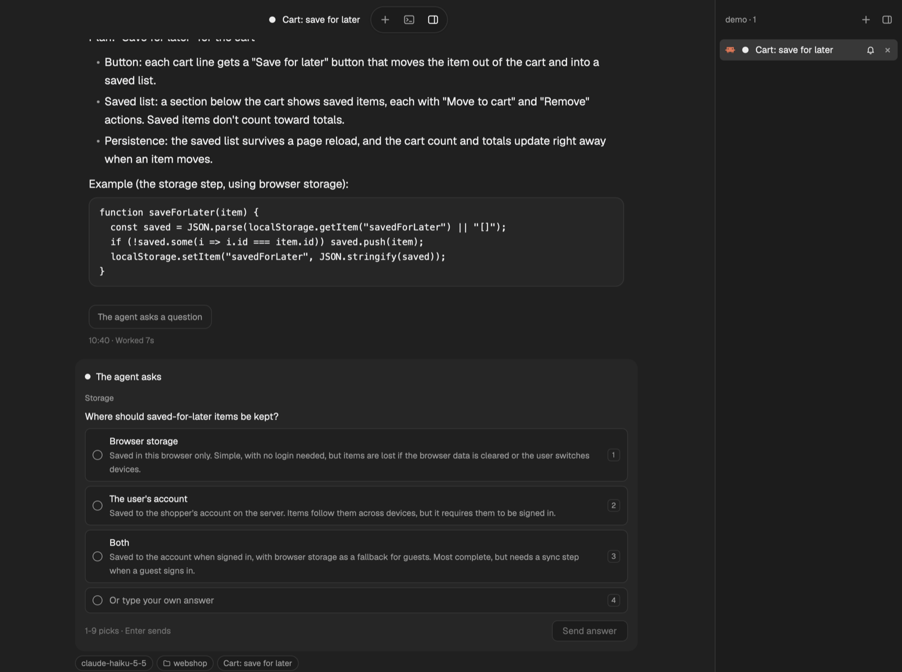

# Flockbook for herdr-app


More screenshots (cards, Needs you, Overview, attachments, the terminal, menus and the floating sidebar) are in the [repository README](../README.md#flockbook-for-the-herdr-app).

Flockbook's reading view, rebuilt as a herdr-app layout and mod. It shows each coding agent as a
conversation instead of a terminal: a floating tab bar with one pill per agent, chat bubbles,
tool-call chips, a status tag row, and a composer.

It needs no change to herdr-app. Where herdr-app's mod API cannot do what Flockbook does, this
version comes close or leaves the feature out.

## Parts

| Path | What it is |
|---|---|
| `layouts/flockbook.json` | The window: a hidden sidebar and a stack of screens (chat, Needs you, Overview, the tab's panes). Each screen draws the top bar. |
| `mods/flockbook/` | One mod with several views. Each layout block picks one with `props.view`: `top`, `side`, `chat`, `needs`, `overview`; popups use `termbar` and `menu`. |
| `themes/` | Flockbook and Flockbook Mac themes, dark and light. |
| `test/` | Node tests with fake `gpui-kit`, `gpui-base` and `herdr` modules. |
| `keys.json` | The Flockbook shortcuts, in a `layout:flockbook` section (while this layout shows). Do not add a `mod:flockbook` section: with one, no key worked. |
| `install.sh` | In the release zip: runs this machine's helper (`bin/` on macOS, `remote/<target>/` on Linux, checked against `remote/SHA256SUMS`) as `flockbook-modfeed install`, which installs the layout, the mod, the themes, the keys and the helpers into your herdr-app home, without overwriting yours. |
| `install-isolated.sh` | Copies the same into a test herdr-app home, for development. |

The chat view reads conversations through a sidecar, `flockbook-modfeed`, built from this repo
(Rust: `cd xplat && cargo build --release -p flockbook-modfeed`). The mod finds it at
`<herdr-app home>/flockbook/bin/flockbook-modfeed`. Its protocol is in `docs/protocol.md`.

The layout and the mod work only together: the layout names the mod's views, and the mod expects
the layout's ids (`sidebar`, `screen`, `chat`, `tab`). The mod alone draws nothing (`place` is
`none`); the layout alone shows empty blocks where the views should be. The keys and themes are optional.

A mod cannot import files from another mod's folder, so all views live in one mod.

## Flockbook plus (this build)

This branch is a personal build of the Herdr mod on top of upstream Flockbook, shared so it can be installed
as is. Everything upstream does still works; the list below is what it adds. Every change against upstream,
file by file, is in [`CHANGELOG-plus.md`](CHANGELOG-plus.md).



<sub>The tab is named after the session's topic; the agent's question is a card above the reply box (1–4 pick,
Enter sends); the vertical tab list on the right shows each tab's program, status and bell.</sub>

### What this build adds

**Tabs and names**
- Tabs without a name of their own are named from the session's title (Claude Code's conversation summary,
  like VS Code's terminal tabs), without the spinner marks; the full title is the pill's tooltip. Double-click
  a pill, or the tab menu's **Keep name**, to keep the current topic as the tab's name; **Name from session
  again** goes back. The terminal window's header names the agent too.
- A vertical **tab list** down the right of the window (like VS Code's terminal list): every tab of the shown
  workspace stays in sight, scrolls to the shown one, shows ⌘1–⌘9 hints and each tab's status. A working
  agent's icon dances (hops and sways) until its work stops; Settings → General → Tab list turns it off.
- The sidebar's workspace status marks say which tab they are on hover.

**Overview**
- Status groups **Working → CI / Final Review / Merging → Done → Resting**, each split into sub-groups (Ready to
  merge, Asks you to reply, Hand-off given, Merging, Review results waiting, Waiting on CI, Waiting on a review,
  In review, Agents at work, Running in the background), with "N waiting on you" counts.
- A **Now:** line on each card (what the agent does right now, read off its screen, free) and an **About:**
  line (one plain-English sentence on what the work is for, written by Haiku from the tab's screen: once per
  tab, again when its title changes; a daily cap per account; "Pause until tomorrow"; off in Settings).
- **Hover boxes** on cards, tab pills and tab-list rows: the About line and a few sentences more, the last
  steps, the helpers at work, links to **Summarize** and **Rewrite**.
- **Since you last looked**: what changed in each tab while you were away, grouped by what the tab does now
  (**Waiting on you**, **Merging, CI or review**, **Working**, **Finished**, **Closed**), every group folded at first: open one by its heading, or **Expand all** / **Collapse all**. Each tab is
  a small card: its name and account, how long ago it changed, what it does now, its About line, and its changes as
  time chips that name the day where it changes ("yesterday 10:15 pm"). A click opens the tab; **Copy** puts the
  same layout on the clipboard as text (with a "Copied" notice); **Mark seen** clears it.
- A tab that finished with a **hand-off** ("Hand-off given") gets **Copy prompt** on its Overview card and its
  "Since you last looked" card: it copies the re-entry prompt from that tab's last reply without opening the tab.
- Times say their day when it isn't today: "paused until tomorrow 1:00 am", "yesterday 9:10 pm", "Sat 1:00 am".
- **Resume after a restart**: the Claude sessions that were open when Herdr Core or the Mac restarted are
  offered back (**Resume**, **Resume all**, **Dismiss**); each opens in its workspace and folder, as its
  account, with `claude --resume`. A row being opened says "Opening…".
- An account that ran out of usage shows when it comes back, and its tabs say they are likely paused.
- Fix: the cards no longer spill off both sides after the window shrinks.

**Needs you**
- Besides question cards, it lists replies that end asking you something in words ('say "OK, run both"') or
  with a question, an MCP server's input request (🔌), and how long each has waited ("waiting 2 h").
- A finished turn that still runs a shell or a sub-agent in the background is not "Done": it says what still
  runs, and a CI watch or a review it waits on files it under **Waiting on CI** / **Waiting on a review**.
- **Summarize this tab** (tab menu): what the work is about, what it did, what it does now and whether it waits
  for you, "at a glance", in plain English.

**Chat**
- **Send anyway** when Claude Code shows a dim "/" suggestion in its box, so a message isn't swallowed by it
  (only into the same conversation: after a `/clear` or `/resume` meanwhile it types nothing).
- After `/clear`, a send goes to the new conversation (the chat follows it).
- Answers Claude Code can't take typed (some symbols) say so and offer the terminal (a Codex question answered
  by a message takes any text); drafts are kept per agent.
- Selected text in the reply and answer boxes is highlighted in the theme's selection blue.
- A reply that ends with a **re-entry prompt** (a quote or code block named "Re-entry prompt:" above it, called "ready to paste" under it, starting "Continue …", or answering a message that asked for one) gets
  **Copy all** on its footer line: one click puts the whole prompt on the clipboard, a small notice says it was
  copied, and the button says "Copied" for 2 seconds. Right-click the reply → **Copy re-entry prompt** does the same.
- Optional: each session's own **status line** in the chat header (see "Status line" below).

**Terminal window**
- Drag its right or bottom edge or corner to any size (kept), or pick Small / Default / Large / Full in
  Settings or with the − + buttons on its title bar; double-click the bar for full size.

**Keys** (in this build's `keys.json`, installed with the helper)
- ⌥⌘B shows or hides the tab list; ⌘⇧K keeps the shown tab's topic as its name; ⌘⇧M opens its
  **Move to …** rows. `--copy-only` keeps your `keys.json`: add these three there by hand if you want them.

**Workspaces** (off until set up, see Settings)
- The tab menu's **Move to <workspace>** moves a session's tab without switching your view.
- **Move sessions to their project**: a session started in a "~" workspace moves once to its project's
  workspace when its title names the project or its work happens in the project's folder; a tab in the
  wrong workspace gets a "→ project?" badge.

**Themes**: VS Code–style colours and a visible selection colour for Flockbook dark and light.

**Helper** (`flockbook-modfeed`, built from this branch by `install.sh --build-helper`)
- A send over Claude Code's dim "/" suggestion goes through instead of stopping at "the box has text".
- A comma in a single-choice answer's label is no longer taken as two answers.
- Both are upstream's own fixes now (main, after the 0.13.0 release): building the helper from this branch gets
  them before the next official release.
- If an official Flockbook update puts the official helper back, a notice says which fixes are gone and how to
  rebuild.

### Install (a friend's Mac)

You need the Herdr app (macOS or Linux), `git`, and for the helper fixes Rust's `cargo` (<https://rustup.rs>).

```sh
git clone <this fork's URL> flockbook-herdr-plus   # a full clone, not --depth 1 (the tags and history matter)
cd flockbook-herdr-plus
git checkout custom/flockbook-herdr-plus
cd herdr-app
./install.sh --dry-run     # what it would do
./install.sh               # builds the helper (asks first), installs, switches Herdr to the flockbook layout
```

- `./install.sh --build-helper` builds without asking; `--no-layout` leaves your layout alone.
- No Rust? `./install.sh --copy-only` copies the mod, layout and themes over an installed official Flockbook
  (install that first) and keeps its helper; the old files are backed up in `flockbook/backups/`.
- Like the official installer it never overwrites a file you changed yourself: it stops and names it.

### Updating

```sh
cd flockbook-herdr-plus && git pull && cd herdr-app && ./install.sh
```

Your settings live in `<herdr-app home>/flockbook/config.json`, which no install ever writes, so they are kept.
The "Flockbook X is out" notice means upstream released something: this build gets it once its branch is
updated, so update with the command above, not the official one-line installer (that would put the official
mod back over this one).

### Settings

The Flockbook settings (sidebar → **Flockbook**, or ⌘⇧,) have a **Workflow** section. These read a particular
way of working, so they are **off** unless you turn them on:

| Setting | What it does when on |
|---|---|
| Review-pipeline asks (`pipeline_asks`) | A reply ending with `🔁 Extra review round needed #N: round K · … · repo …`, `🔀 Ready to merge #N — say "merge"` or `reply "go migration N"` is listed under Needs you, with **Extra round** / **Merge** buttons that first check the screen still asks; a tab whose title shows 🔀 is checked on GitHub (`gh`) until its PR is merged. |
| Hand-off marks (`handoff_marks`) | A finished tab whose last reply hands over to a fresh session ("yes, clear", a "re-entry prompt") gets 🤝 and goes under Done → Hand-off given. |
| "Also worth considering" lists (`worth_considering`) | A reply that ends with such a list of optional ideas isn't taken as asking you something. |
| Move sessions to their project (`auto_move`) | See Workspaces above; needs `projects`. |

Two lists are set in `config.json` by hand (the dialog shows what is in use):

```json
{
  "accounts": [
    { "mark": "WORK", "name": "Work account", "config_dir": "~/.claude-work" },
    { "mark": "HOME", "name": "Personal account" }
  ],
  "projects": [
    { "workspace": "webshop", "folder": "~/code/webshop", "title": "web\\s*shop" },
    { "workspace": "tools", "folder": "~/code/tools", "suggest_only": true }
  ],
  "claude_path": "~/.local/bin/claude"
}
```

- `accounts`: only if you run Claude Code with more than one account (`CLAUDE_CONFIG_DIR`). Without it there is
  one account, the default `~/.claude`, and nothing more is needed. With several, each account's Claude Code
  status line must show its `mark` after a `|` (e.g. `you:~/code | WORK …`), so the About lines, Summarize and
  Resume run as the tab's own account; one entry may leave out `config_dir` (the default folder).
- `projects`: the workspaces sessions may move to. `title` is a pattern (any case) the session title matches;
  `suggest_only` only offers the move. Create the workspaces in Herdr with the same names.
- `claude_path`: only if `claude` is not in `~/.local/bin`, `~/.npm-global/bin`, `~/.claude/local`,
  `/opt/homebrew/bin` or `/usr/local/bin`.
- `helper_rebuild`: the command the "patched helper replaced" notice shows (default: `./install.sh --build-helper`).

The About lines and Summarize run `claude -p --model haiku` with the tab's screen as the prompt (no tools, no
MCP servers, nothing saved), on the tab's own account, so they use that account's usage. Turn them off in
Settings → Overview → About lines.

### Tab-title symbols (optional)

Some groups use symbols a Claude Code hook can put in front of a session's terminal title: ⏳ (CI running), 🔍
(Codex review), 🟣 🟠 🔵 🟢 ⚪ (a review agent by model), 🛠 🧪 📐 🧭 (build, test, plan, lookup agents), ✅ (review
results waiting), 🔀 (ready to merge / merging). Without such a hook the titles have none and the groups that
need them stay empty; everything else works.

### Status line (optional)

To show each session's own Claude Code status line in the chat header (the install copies the wrapper):

```sh
node extras/enable-statusline.mjs            # wraps statusLine.command in ~/.claude/settings.json
node extras/enable-statusline.mjs --undo     # back to your plain status line
```

Add `--config-dir <folder>` for another account's config folder. It needs a status line command already set up
in Claude Code (`/statusline`); what Claude Code shows does not change.

### Tests

`npm test` runs upstream's suite and then this build's own (`test/plus/`, `npm run test:plus` alone).

The sidebar column has the id `sidebar`, so herdr-app's own ⌘B (`layout.toggle:sidebar`) opens and closes it.

## Install

This needs herdr-app on macOS or Linux. The mod runs programs: its helper `flockbook-modfeed` (which runs
`hc` and sends keys and text to an agent's terminal, only when you press or type) and, on macOS,
`osascript` (the file dialog). On Linux the + file dialog is off: drop files on the chat or paste an image. It reads the agents' session logs outside its folder (`~/.claude/projects/`,
`~/.codex/sessions/` and others; see `RECIPE.md`). It goes on the network only to check once a day for
a newer Flockbook (api.github.com); turn it off in the Flockbook settings (sidebar, **Flockbook**), which
also has the status row and the helper on other machines. They are kept in `flockbook/config.json`.

`flockbook-modfeed install` (the layout, the mod, the themes and the keys are built into the helper)
copies them into your herdr-app home, merges `keys.json`, puts the helper in `flockbook/bin/` and the
helpers for other machines in `flockbook/remote/<target>/` (checked against `SHA256SUMS`), and runs
`herdr-app check`. It needs no python3. It never overwrites what you
have: if a layout, mod or theme called flockbook is there and it did not put it there, it stops
and writes nothing. The one exception is an older Flockbook nobody changed (a gallery copy, an older
zip): each file whose checksum is one of an earlier version's is replaced, and the plan names the
version. A key you already use keeps your command. Add `--dry-run` to see the plan
first. The home is `--home <folder>`, else `$HERDR_APP_HOME`, else `~/.config/herdr-app`.

In one line (macOS or Linux): it downloads the helpers and `SHA256SUMS` from the latest release,
stops if a sum does not match, and runs `flockbook-modfeed install` (add `-s -- --dry-run` after `sh`):

```sh
curl -fsSL https://github.com/minchenlee/flockbook/releases/latest/download/install.sh | sh
```

From a release zip: download `Flockbook-herdr-mod-<version>.zip` from
<https://github.com/minchenlee/flockbook/releases>. It has this folder's layout, mod, themes, keys
and install scripts, a universal, signed `flockbook-modfeed` in `bin/`, and the helper for each
platform in `remote/<target>/` (`universal-apple-darwin`, `x86_64-unknown-linux-musl`,
`aarch64-unknown-linux-musl`) with `remote/SHA256SUMS`. Unzip it, then:

```sh
./install.sh --dry-run
./install.sh
```

From the repo (in its root):

```sh
(cd xplat && cargo build --release -p flockbook-modfeed)
xplat/target/release/flockbook-modfeed install --helper xplat/target/release/flockbook-modfeed
```

From the gallery (herdr.dev/layouts): the agent copies only `layouts/` and `mods/`. Get the
helper from a release or build it as above, and copy it to
`<herdr-app home>/flockbook/bin/flockbook-modfeed`. Without it the chat says the helper is
missing; the other views work.

Then pick the layout in herdr-app with `layout.switch {"name": "flockbook"}`. `ctrl-shift-l`
switches back to your own layout.

## Try it in a test home

For development, install into a test home instead of your real one. `install-isolated.sh` refuses
`~/.config/herdr-app` and replaces its own earlier copy without asking:

```sh
mkdir -p /tmp/flockbook-test-home
./install-isolated.sh /tmp/flockbook-test-home path/to/flockbook-modfeed
HERDR_APP_HOME=/tmp/flockbook-test-home herdr-app check /tmp/flockbook-test-home/mods/flockbook
```

Then start herdr-app with `HERDR_APP_HOME=/tmp/flockbook-test-home` and pick the layout with
`layout.switch {"name": "flockbook"}`.

## Tests

```sh
npm test
```

## Release notes

Each change people can see adds one line to the repo's `docs/release-notes/next.md`.
